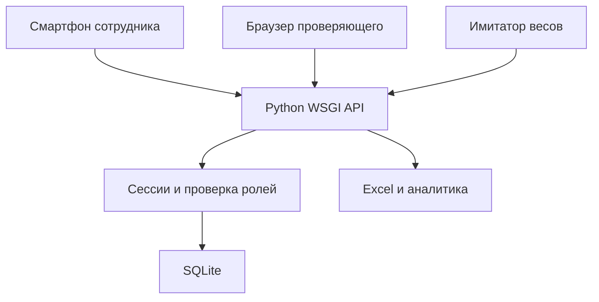
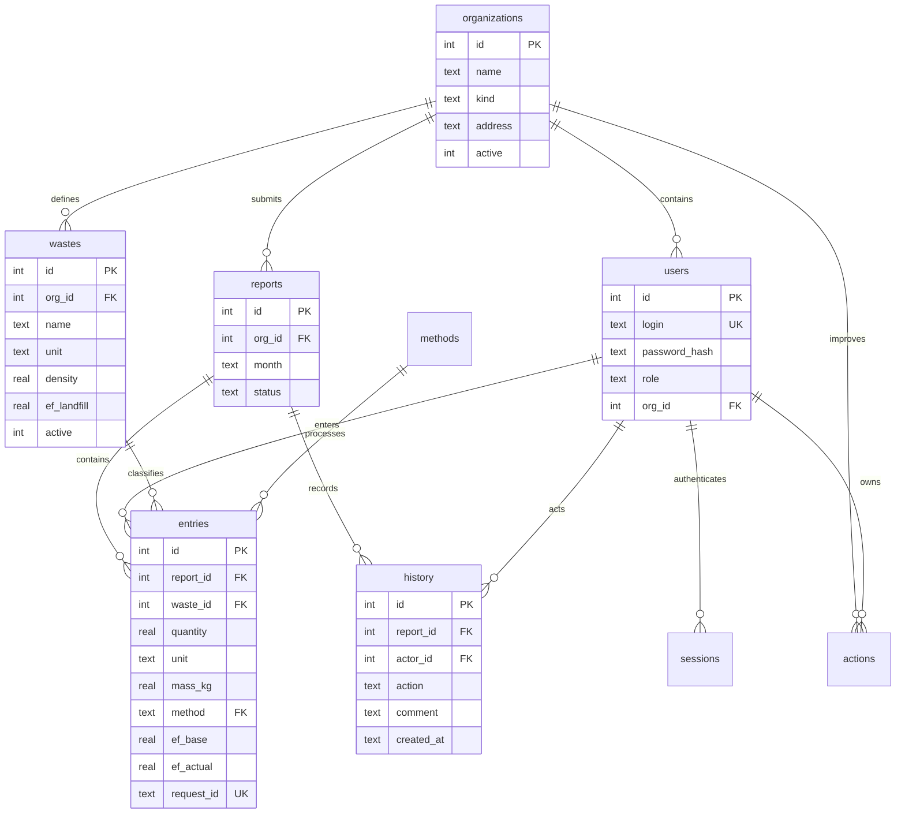
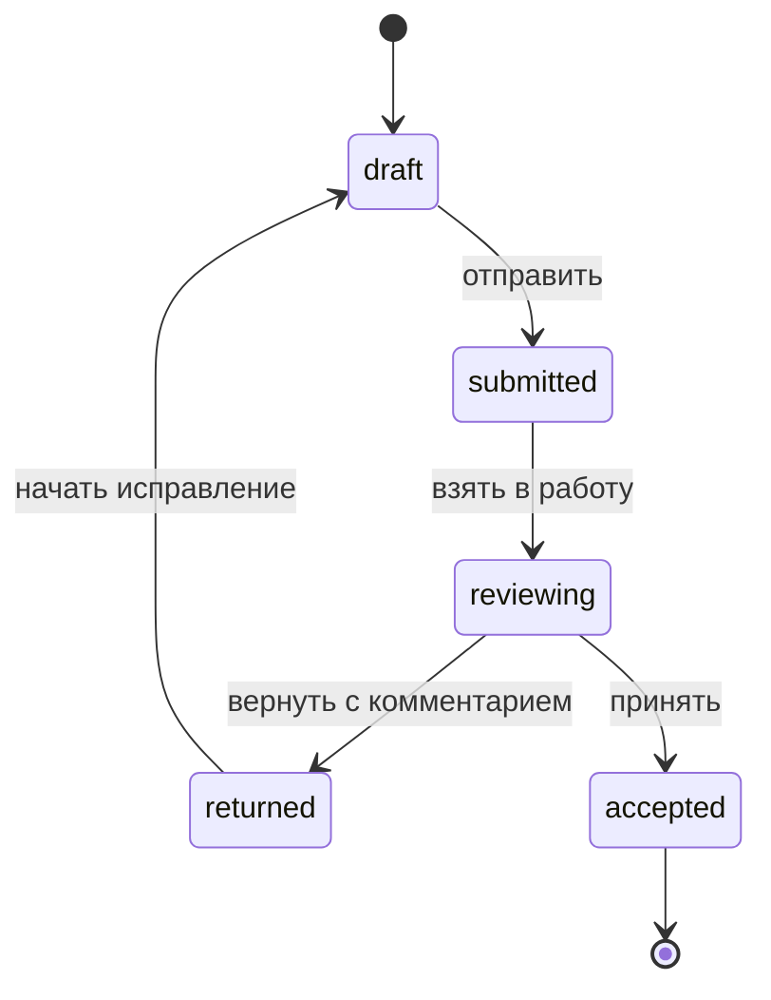
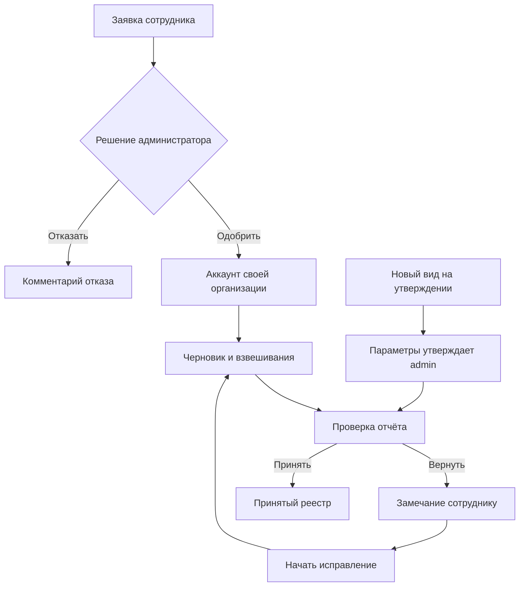

# Архитектура FoodLoop ATU

MVP состоит из браузерного интерфейса, Python WSGI-приложения и SQLite. В браузере нет копии реестра вместо базы: все принятые записи, роли и статусы обрабатывает сервер. JavaScript хранит только несохранённый черновик формы и текущий вид интерфейса.

В разработке и на ноутбуке используется многопоточный WSGI-сервер стандартной библиотеки. Для размещения подготовлен запуск под Waitress за HTTPS-прокси. На хакатоне не требуется внешняя база или платный сервис.

## Сущности и связи

Ограничение `UNIQUE(org_id, month)` не допускает двух отчётов организации за один месяц. Для истории действий используется отдельная таблица. Исходное количество, единица, расчётная масса и коэффициенты копируются в запись: исторический расчёт не зависит от последующей деактивации справочника. Данные пользователя и исходные записи не удаляются каскадно.

## Проверка отчётов

Возвращённый отчёт остаётся видимым как «Возвращено». Ответственный нажимает «Начать исправление»: отчёт переходит в черновик, замечание сохраняется в истории. Только черновик редактируется. После принятия строки блокируются API и триггерами SQLite. Ошибку в уже принятом отчёте в этом MVP нельзя исправить через интерфейс: в пилоте нужен процесс корректировочного отчёта с версиями. Прямая правка БД не является штатным способом исправления.

## Безопасность

- Пароль: PBKDF2-HMAC-SHA256, 600 000 итераций, индивидуальная случайная соль при создании реальной учётной записи. В демонстрационном seed общий пароль намеренный, только для синтетических данных.
- Случайная сессия на 12 часов, в базе хранится хеш токена. Cookie `HttpOnly; SameSite=Lax`, флаг Secure включается через `COOKIE_SECURE=1` для HTTPS.
- Каждая операция записи требует CSRF-токен и проверяет Origin при наличии заголовка.
- SQL-запросы параметризованы. Отображение пользовательского текста экранируется.
- Ограничение JSON-запроса 800 000 байт; само фото — максимум 500 КБ. После 10 неудачных попыток входа для пары IP/логин блокировка на 15 минут.
- Выгрузка пишет текст как inline strings, не как Excel-формулы.
- `BEGIN IMMEDIATE` сериализует операции записи, чтобы принятие и исправление не выполнялись одновременно.

Это меры MVP, не заключение об аудите безопасности или юридическом соответствии. Для реальной эксплуатации нужны TLS, резервные копии, правила обработки служебных данных, мониторинг и проверка доступа.

## Основные API

| Метод и путь | Назначение |
|---|---|
| POST `/api/login` | Логин и пароль, возвращает CSRF, выставляет cookie |
| GET `/api/me` | Текущая сессия и роль |
| POST `/api/logout` | Завершение текущей сессии |
| POST `/api/password` | Смена собственного пароля |
| GET `/api/bootstrap` | Справочники в пределах роли |
| GET, POST `/api/reports` | Список, открытие или создание месячного отчёта |
| GET `/api/reports/{id}` | Записи, статус, история |
| POST `/api/reports/{id}/entries` | Новое взвешивание |
| PATCH, DELETE `/api/entries/{id}` | Исправление, удаление редактируемой записи |
| POST `/api/reports/{id}/transition` | Переход статуса |
| GET `/api/registry` | Принятые записи |
| GET `/api/analytics` | Показатели и рекомендации |
| GET `/api/export` | Excel: свод, детали, методика и журналы пяти организаций |
| GET `/api/missing?month=YYYY-MM` | Организации без принятого отчёта |
| POST `/api/wastes` | Новый вид для организации |
| PATCH `/api/wastes/{id}` | Активация / деактивация администратором |
| POST `/api/organizations` | Новая организация, только администратор |
| GET, POST `/api/users` | Пользователи, только администратор |
| GET, POST `/api/actions` | План улучшений |
| PATCH `/api/actions/{id}` | Запись результата действия |
| POST `/api/scale` | Программная имитация показания весов |

Фильтры реестра, аналитики и Excel: `from`, `to` (ISO-даты), `org_id`, `waste_id`, `method`. Для оператора сервер дополнительно всегда накладывает ограничение его организации.

Взвешивание: `waste_id`, `quantity`, `date`, `method`, необязательные `reason`, `portions`, `request_id`, `source`. Способ DONATE/FEED требует `safe_confirm: true`. Вероятный дубль возвращает HTTP 409 и `duplicate: true`; отдельное повторное измерение подтверждается `confirm_duplicate: true`.

Интеграция с треком 2 пока демонстрационная: `/api/scale` возвращает источник `simulator`, килограммы, время и идентификатор устройства. Для физических весов понадобятся адаптер протокола, калибровка, отдельная аутентификация устройства и проверка повторов событий. Подключение реального оборудования не заявляется.

## Итоговая доработка: допуск и расширения

Основной код `server.py`, расширения и миграции `features.py`, интерфейс `static/app.js` + `static/features.js`. При старте добавляются поля и таблицы без удаления записей. Принятые отчёты сохраняют блокировку.

Новые сущности: access_requests (хеш пароля, организация, решение), audit (административные действия), photos (ссылка на запись, MIME, байты, автор, дата). В wastes добавлены approved, proposed_by, default_method; в reports — даты отправки/решения и проверяющий; в users — служебный e-mail. Секретные значения не записываются в аудит.

Новые маршруты: POST /api/access-requests, GET /api/access-options, GET /api/public-config (публичные). Остальные требуют сессию: GET/PATCH заявок, PATCH организаций и пользователей, POST утверждения вида, GET аудита, GET сравнения, GET QR, GET/POST/DELETE фото записи. На мутациях сессии проверяются CSRF/Origin. Публичная заявка ограничена по IP и всегда создаёт только operator после одобрения.

Отключение пользователя/организации и смена назначений отзывают сессии. Самоотключение admin и потеря последнего активного администратора запрещены. Все роли проверяет сервер. QR содержит только адрес формы и id организации.

Фото защищено областью организации и статусом отчёта, предел 500 КБ, JPEG/PNG с проверкой сигнатуры. На клиенте canvas уменьшает изображение и убирает EXIF при пересохранении. Изображение не исполняется как HTML/SVG. В рабочей среде нужны HTTPS, резервирование и согласованный срок хранения фото.

QR генерирует локальная копия python-qrcode 8.2 (BSD). Pillow для приложения не требуется. Внешний сервис QR не используется.

Сравнение учитывает именно принятые строки выбранного периода и фильтров. Полный календарный интервал сравнивается с предыдущим таким интервалом. Неполный/произвольный — с предыдущим равным числом дней. Нулевая база даёт «нет базы», а не выдуманный процент.

Перед принятием проверяются утверждение видов и соответствие снимков плотности/коэффициентов текущему справочнику. При изменении параметров черновую запись нужно пересохранить; принятые значения не пересчитываются задним числом.
